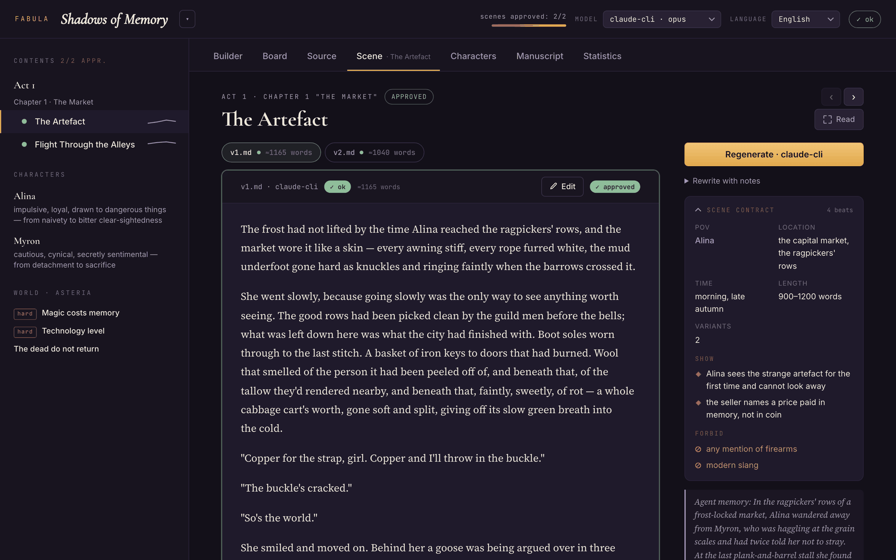
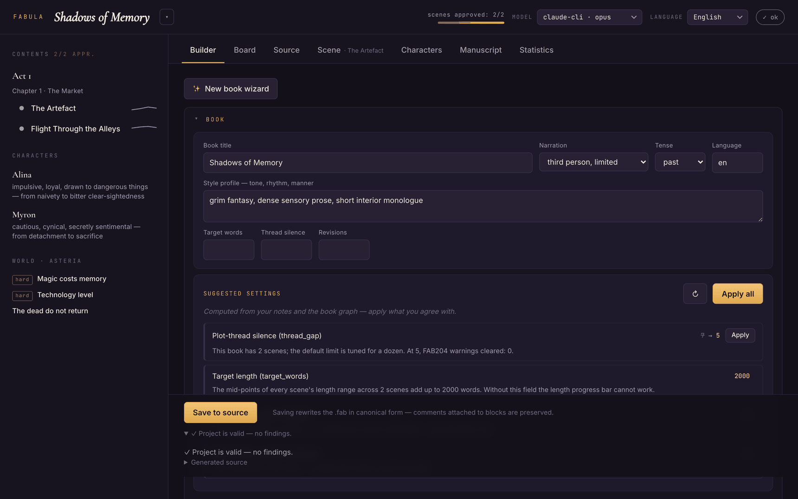
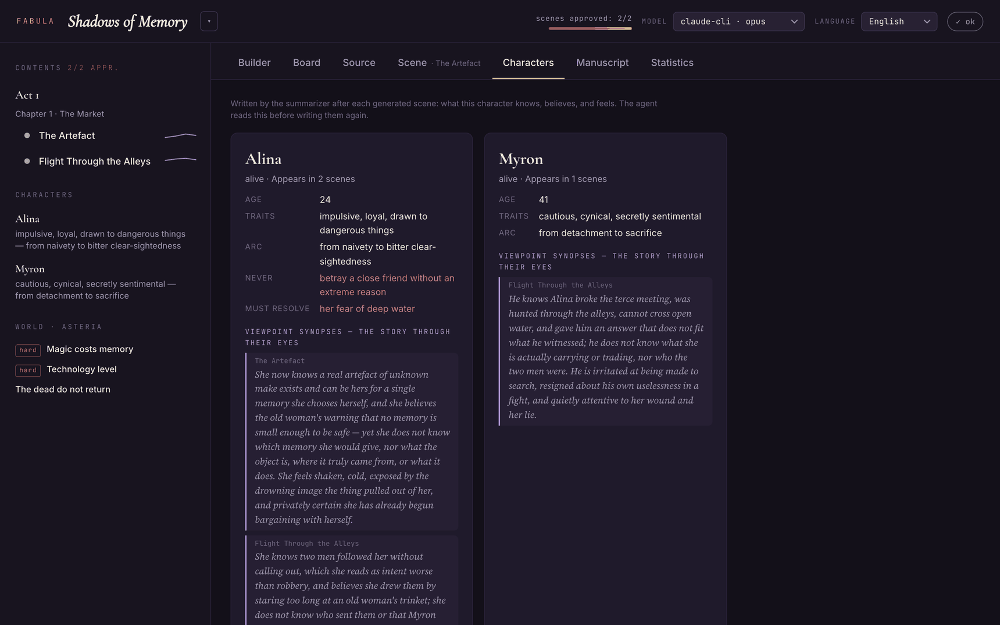

# Fabula — an AI-first language for book-writing agents

[](https://github.com/korshak/fabula/actions/workflows/ci.yml)

[Українська версія](README.uk.md)

Fabula is a DSL whose primary "reader" is not a human but a writing agent —
plus a local web studio for the human editor. You describe a book formally
(world rules, characters with constraints, scenes as contracts); an LLM agent
writes the prose, checks itself against the contracts, keeps memory between
scenes, and a human approves the best variants into a manuscript.

## What it looks like



**Scene** — the prose gets the whole page, with the scene contract (POV, location,
mandatory beats, bans), a variant switcher carrying validator verdicts, and the
memory the agent carried in, on a rail beside it.



**Builder** — the book is edited as a form, not as syntax: POV and cast picked
from declared entities, tension as sliders, live validation, and settings the
tool works out from your own graph and offers to apply.



**Characters** — a card per character, and under it the viewpoint synopses the
summarizer writes after every scene: what they know, still don't know, believe,
and feel. The agent reads this back before writing them again, so nobody acts on
knowledge they could not have.


**Manuscript** — approved scenes stitched into one text under their act and
chapter headings, with a slug line above each scene, ready to copy, download as
Markdown, export as EPUB, or hand to the translator agent.

## Install

Only Python ≥ 3.10 is required — the core has zero dependencies (stdlib only).

```bash
pipx install git+https://github.com/korshak/fabula.git
```

Or with pip (in a venv): `pip install git+https://github.com/korshak/fabula.git`,
or from a clone: `pip install .` The Anthropic API provider is an optional
extra: `pip install "fabula-lang[anthropic]"`; the claude-cli and
openai-compatible providers need nothing extra.

## Local setup (from a clone)

Nothing but a Python ≥ 3.10 interpreter is required — the core is stdlib-only.

**1. Clone and create a virtualenv**

```bash
git clone https://github.com/korshak/fabula.git && cd fabula
python3 -m venv .venv && source .venv/bin/activate
```

On Windows the last step is `.venv\Scripts\activate`.

**2. Install**

```bash
pip install -e .
```

That puts `fabula` on PATH and keeps it pointing at the working tree, so edits
take effect without reinstalling. Add the Anthropic SDK only if you plan to use
the `anthropic` provider: `pip install -e ".[anthropic]"`. You can also skip the
install entirely and run `python3 -m fabula …` from the repo root.

**3. Point it at a model**

Nothing generates prose until at least one provider is reachable. The profiles
live in [books/models.json](books/models.json) and apply library-wide; pick
whichever you already have:

```bash
# claude-cli — the default profile, no API key: needs `claude` (Claude Code) in PATH
claude --version

# anthropic — the SDK plus a key
pip install anthropic && export ANTHROPIC_API_KEY=...

# openai-compatible — the key goes in the env var named by the profile's api_key_env
export OPENAI_API_KEY=...      # or GEMINI_API_KEY, OpenRouter, …
# a local server (the `ollama` profile) needs no key at all
```

Keys are only ever read from the environment — `models.json` stores the *name*
of the variable, never its value, so the file is safe to commit. Check what is
actually live:

```bash
fabula models "Тіні пам'яті"
```

Full details — where the config is looked up, every profile key, running a local
model — are in [Models: setting up a provider](#models-setting-up-a-provider).

**4. Run the studio**

```bash
fabula serve
```

It opens http://127.0.0.1:8787 on the most recently used book, falling back to
the bundled sample. `--port 8899` moves it; `python3 run_ui.py 8899` is the
equivalent entry point used by the editor launch config.

**5. Write something**

```bash
fabula init my-book          # scaffolds books/my-book
fabula compile my-book       # diagnostics as JSON
fabula plan my-book          # the outline
fabula write my-book -m claude-cli
fabula manuscript my-book -o book.md
```

### Where the data lives

| path | what | in git? |
|---|---|---|
| `books/<name>/book.fab` | the book source | your books are gitignored; `books/Тіні пам'яті/` ships as the sample |
| `books/<name>/build/` | generated state: variants, approvals, summaries, translations | no |
| `books/models.json` | library-wide provider profiles | yes (env var names only) |
| `~/.fabula/projects.json` | recently opened books, for the studio's project switcher | outside the checkout |

Three environment variables adjust this: `FABULA_BOOKS` moves the library out of
the checkout, `FABULA_HOME` moves `~/.fabula`, and `FABULA_LANG` (`uk` or `en`)
sets the interface and scaffold language. With `FABULA_LANG` unset the interface
follows your system locale, falling back to English. The UI language is
independent of the prompts sent to the writing model, which follow each book's
own `language` setting.

### Troubleshooting

- **`fabula: command not found`** — the virtualenv isn't active, or the install
  was skipped; `python3 -m fabula …` from the repo root always works.
- **`Address already in use`** — something else holds 8787: `fabula serve --port 8899`.
- **A provider shows as unavailable in `fabula models`** — the message says why:
  `claude` missing from PATH, the `anthropic` package not installed, an unset
  key variable, or a local endpoint that isn't answering.
- **Nothing in the library** — `fabula serve` needs at least one book; run
  `fabula init my-book` first, or clone with the sample book intact.

## Quick start

```bash
fabula init my-book
```

```bash
fabula serve
```

`init` scaffolds a book (`book.fab` + `models.json` + `.gitignore`) in
`books/my-book`; `serve` opens the web studio at http://127.0.0.1:8787 with the
library's most recent book — start in the **Builder** tab. Interface and
scaffold language: `--lang uk` or `FABULA_LANG`.

**The library.** Every book lives in its own folder under `books/`, and that
folder holds everything about it: the `book.fab` source, its `models.json`, and
the generated `build/` state (scene variants, approvals, summaries,
translations). A book is moved, copied or deleted as a single directory.
Commands take a book **name** (`fabula plan my-book`) rather than a path; an
explicit path to a `.fab` still works. Point `FABULA_BOOKS` elsewhere to keep
the library outside the checkout.

## What it does

- **Declarative contracts instead of prompts.** A book is described formally:
  a world with hard rules (`severity: hard`), characters with constraints
  (`never`, `must_resolve`) and questionnaire fields (`appearance`, `voice`,
  `wants`, `fears`, `secret`), locations with five-senses detail, named plot
  `thread`s, scenes with mandatory beats (`show`), bans (`forbid`), cast,
  deaths (`kill`), advanced threads, a tension curve, and a length range.
- **Plot threads under watch.** Scenes declare which threads they advance;
  the compiler errors on undeclared threads (`FAB109`) and warns when a
  thread is never advanced (`FAB203`) or goes silent for more than
  `thread_gap` scenes in a row (`FAB204`).
- **Machine-readable diagnostics.** The compiler emits JSON with stable error
  codes and a `hint` field so an agent can repair the source by itself.
  Continuity is checked: `FAB108` won't let a dead character reappear.
- **Memory between scenes.** Every written scene is summarized (with
  structured character state changes); the next scenes receive a hierarchical
  "what happened before" block (the last `memory_window` scenes in full,
  older ones as one line) and a "character state" ledger (alive/dead, last
  location, fresh semantic changes). Summaries always stay fresh:
  regeneration rewrites them, approving a different variant re-summarizes it.
- **Viewpoint synopses.** The summarizer also records each present
  character's own picture of events — what they know, still don't know,
  believe (even mistakenly), and feel. The ledger feeds it back to the agent
  so nobody acts on knowledge they couldn't have; the Characters tab shows
  the story through each character's eyes.
- **Plot templates.** `fabula init my-book --template heros_journey` (or the
  in-studio wizard) unfolds a classic structure — universal three-act,
  hero's journey, mystery, romance, seven-point short story — into acts and
  scene stubs with starter beats, localized to the book's language.
- **Generate → self-check → self-revise.** The agent writes N variants, a
  validator call checks each against the contract, and on violations the
  agent rewrites the text itself (`revisions: 2;` in book settings, default
  1 round). The human approves the best variant — or edits it in place, leaves
  Google-Docs-style inline comments on selected passages — "Apply notes"
  then performs a minimal targeted revision (only the commented passages
  change, the plot stays intact) — or regenerates from scratch with a written
  note — and
  approved scenes stitch into the manuscript.
- **Prompts in the book's language.** Instructions to the writing model
  follow the book's `language` setting (templates live in `fabula/locales/`,
  falling back to English).
- **Self-repair.** `fabula fix` hands the diagnostics to the agent and
  accepts the fixed source only if it compiles again.

## Web studio

- **Projects** — the ▾ menu next to the book title switches between books
  without restarting the server: everything in `books/` plus recently opened
  books (remembered in `~/.fabula/projects.json`), open a book by name or
  path, or create a new one by name — scaffolding included, and the new-book
  wizard opens right after. Each book keeps its own `build/` state next to its
  source, and running generation jobs survive switching away and back.
- **Builder** — form-based project editing, no syntax to type: POV, cast and
  threads are picked from declared entities, length is numeric, tension is
  sliders; sections for locations (five senses) and plot threads; live
  validation and generated source; renaming a scene migrates its variants and
  memory; comments attached to blocks survive saving. The **new book wizard**
  walks premise → characters → plot template and creates the whole structure.
- **Board** — the corkboard: scene index cards grouped by chapter, drag to
  reorder (within or across chapters, saved back to canonical source), and a
  thread × scene map that shows where each plot line advances and where it
  goes silent.
- **Source** — a `.fab` editor with clickable diagnostics, agent-powered fix,
  and code export.
- **Scene** — a reading column that gives the prose the whole page, with the
  scene contract (POV, beats, forbids), generation and the agent's memory on a
  sticky rail beside it; a variant switcher carrying validator verdicts,
  WYSIWYG editing in the same typography (headings, bold, italic,
  strikethrough, code, quotes, lists and tasks, links, tables, scene divider,
  with a toggle to the raw Markdown), approval, and a panel-free reading mode.
- **Characters** — a profile card per character (questionnaire fields,
  constraints, alive/dead, appearances) plus the accumulated viewpoint
  synopses: the story through their eyes, scene by scene.
- **Manuscript** — approved scenes stitched into one text and read by its
  structure: act and chapter headings, and above every scene a slug line
  naming where and when it happens; copy, download as Markdown, or export a
  ready-to-read **EPUB** (chapter headings in the book's language, works in
  any e-reader). The slug lines are a reading aid — the copy, the `.md` and
  the EPUB carry the prose alone. The same tab holds **translations**: the
  translator agent carries the approved scenes into any language while
  preserving the author's style (rhythm, register, imagery), with a per-book
  glossary keeping names, terms, and chapter titles consistent; only scenes
  that changed since the last run are retranslated, and every translation
  exports to Markdown/EPUB like the original.
- **Statistics** — words per scene and per writing day, approved-scene count,
  progress against `target_words`.

The server is pure stdlib; model SDKs are needed only for generation.

## Models: setting up a provider

Fabula never talks to a model until you point it at one. There are three
backends; **`claude-cli` needs no API key at all** and is the default.

### Where the config lives

Providers are described in `models.json`. Fabula looks for it in this order and
takes the first hit:

1. `books/<your-book>/models.json` — settings for that one book
2. `books/models.json` — the library-wide default (this is the one shipped here)
3. `./models.json` — the current working directory

If none exists, a built-in default config is used, so a fresh clone already has
all five profiles below. You only need to write a `models.json` to change
something.

Check what is live at any time — the command prints which config file it read:

```bash
fabula models my-book
```

```
config: /path/to/fabula/books/models.json
 → claude-cli   claude-cli opus                   ok
   claude-api   anthropic  claude-opus-5          unavailable — SDK not installed — run: pip install anthropic
   gpt          openai     gpt-5.2                unavailable — token not set — export OPENAI_API_KEY=...
   gemini       openai     gemini-2.5-pro         unavailable — token not set — export GEMINI_API_KEY=...
   ollama       openai     llama3.3               unavailable — no connection to http://localhost:11434/v1 — start the server or fix base_url
```

The arrow marks the default profile. In the studio the model is a dropdown in
the header; in the CLI it is `-m <profile>`. Every scene variant records which
provider wrote it.

### `claude-cli` — no API key

Uses the `claude` console tool you already have from Claude Code, in headless
print mode, under your existing Claude Code authentication. Nothing to install
beyond the CLI itself, and no key ever touches the config.

```bash
claude --version        # must be on PATH
```

```json
{"type": "claude-cli", "model": "opus"}
```

`model` is passed straight through as `--model`, so anything the CLI accepts
(`opus`, `sonnet`, `haiku`, a full model id) works; omit it to use the CLI's own
default. Under the hood Fabula runs
`claude -p --output-format json --max-turns 1`, feeding the prompt on stdin and
the book bible via `--append-system-prompt`.

If generation fails with an authentication error, run `claude` once
interactively and log in.

### `anthropic` — the SDK

```bash
pip install anthropic
export ANTHROPIC_API_KEY=...      # or: ant auth login
```

```json
{"type": "anthropic", "model": "claude-opus-5"}
```

`model` is required. This backend streams, uses adaptive thinking, caches the
book-bible prefix between calls, and on `claude-opus-5` / `claude-fable-5`
enables server-side refusal fallbacks. Credentials come from the SDK, so an
`ant auth login` profile works without setting the variable at all.

### `openai` — any OpenAI-compatible endpoint

Plain HTTP against `{base_url}/chat/completions`, no SDK required. Works with
OpenAI, OpenRouter, Gemini's compatibility endpoint, Ollama, llama.cpp,
LM Studio, vLLM — anything speaking that protocol.

```json
{"type": "openai", "base_url": "https://api.openai.com/v1",
 "model": "gpt-5.2", "api_key_env": "OPENAI_API_KEY"}
```

`base_url` and `model` are required. `api_key_env` names the **environment
variable** holding the token — the token itself is read from the environment at
call time and is never stored in `models.json`, which is what makes that file
safe to commit. Local servers usually need no key: drop `api_key_env` and
Fabula will probe the endpoint instead of looking for a token.

```bash
# a local model, no key at all
ollama serve && ollama pull llama3.3
```

```json
{"type": "openai", "base_url": "http://localhost:11434/v1", "model": "llama3.3"}
```

### Profile keys

| key | applies to | meaning |
|---|---|---|
| `type` | all | `claude-cli` \| `anthropic` \| `openai` |
| `model` | all | model id; required for `anthropic` and `openai` |
| `base_url` | `openai` | endpoint root, must start with `http://` or `https://` |
| `api_key_env` | `openai` | name of the env var holding the token (uppercase) |
| `timeout` | all | seconds per call, default 900 |
| `extra_params` | `openai` | object merged into the request body (`temperature`, `top_p`, …) |
| `probe` | `openai` | force the reachability check on or off; on by default when there is no `api_key_env` |

Profile names are letters, digits and dashes. The top-level `"default"` key
picks which profile is used when none is given; if it names a profile that does
not exist, the first one wins. A full example lives in
[books/models.json](books/models.json).

### Mixing providers

Profiles are switched per call, so nothing stops you from drafting scenes with
one model and reviewing with another:

```bash
fabula write my-book -m claude-cli     # draft locally, no key
fabula write my-book -m gpt            # a second opinion on the same scene
fabula translate my-book --to en -m claude-api
```

## CLI

```bash
fabula init my-book              # scaffold a new book in books/
fabula init my-book --template mystery   # …from a plot template
fabula templates                 # list plot templates
fabula compile my-book           # JSON graph + diagnostics
fabula plan my-book              # outline
fabula models my-book            # provider profiles and status
fabula prompt my-book -s "Scene"     # the exact agent prompts
fabula write my-book -m claude-cli   # generate scenes
fabula fix my-book --dry-run     # agent-powered source repair
fabula manuscript my-book -o book.md
fabula epub my-book -o book.epub     # e-reader export
fabula translate my-book --to en     # style-preserving translation
fabula manuscript my-book --translation en -o book.en.md
fabula epub my-book --translation en -o book.en.epub
fabula serve                     # web studio over the library
```

In a clone without installing: `python3 -m fabula …`

## Localization

All user-facing strings (web UI, CLI, compiler diagnostics, provider errors,
agent progress) live in `fabula/locales/<code>.json` — Ukrainian and English
ship out of the box. Adding a language is dropping one JSON file in, no code
changes: see [fabula/locales/README.md](fabula/locales/README.md). Partial
translations fall back to English; plural forms are supported. The UI locale
does not affect the prompts sent to the writing model — those follow the
book's `language`.

## Language reference

See [docs/LANGUAGE.md](docs/LANGUAGE.md) for the grammar, block semantics,
settings keys, and the full diagnostics table.

## Development

`pip install -e .` for local development; release artifacts via
`python3 -m build`. Packaging lives in [pyproject.toml](pyproject.toml)
(zero runtime deps; locales and the web UI ship inside the wheel).

```bash
python3 -m unittest discover -s tests -t .
```

Stdlib `unittest`, no network and no API key. CI runs the same suite on Linux,
macOS and Windows across Python 3.10–3.13.
Contributions: [CONTRIBUTING.md](CONTRIBUTING.md).

## Privacy and safety

Fabula runs entirely on your machine. There is no Fabula service, no account and
no telemetry — the only traffic it makes is the call to whichever model provider
you configured yourself. Your books never leave the folder they live in.

API keys are read from environment variables only. `models.json` stores the
*name* of the variable, never its value, which is why it is safe to commit.

`fabula serve` binds to `127.0.0.1` and has no login. It is guarded against the
browser — a page on another site cannot drive it, and a hostname rebound to
`127.0.0.1` cannot reach it — but not against the machine: anyone with an
account on the same host can. Run it on a machine you control, and do not expose
the port. Found a hole? [SECURITY.md](SECURITY.md).

## License

Fabula is released under the [PolyForm Noncommercial License 1.0.0](LICENSE) —
**free for any noncommercial purpose, commercial use is not permitted** without
a separate license. That covers the whole toolchain and any part of it: you may
not lift a module, the compiler, the prompt templates or the studio out of the
project and put them to commercial use.

Permitted without asking anyone: personal projects, hobby writing, study and
research, teaching, and use by charities, schools, universities, public
research bodies and government institutions — including writing and publishing
books you sell, since the restriction is on commercialising *the software*, not
your prose. You may also fork it, change it and redistribute it, as long as the
result stays noncommercial and carries the license along.

Not permitted: using Fabula inside a company's operations, building a product or
paid service on top of it, or bundling it into something you sell. For any of
that, open an [issue](https://github.com/korshak/fabula/issues) to arrange a
commercial license.

Note that this is deliberately **not** an OSI-approved open-source license.
