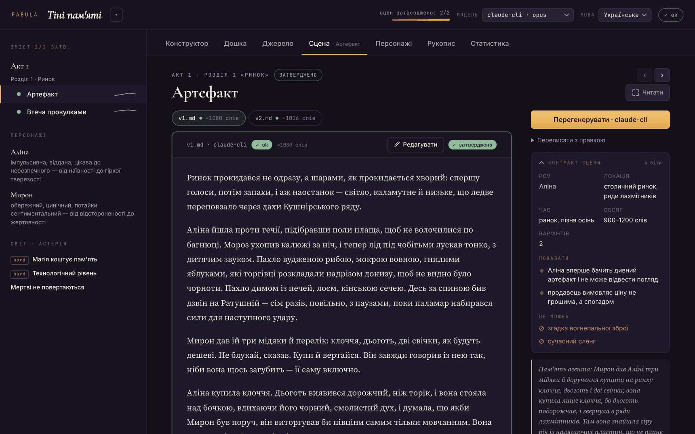
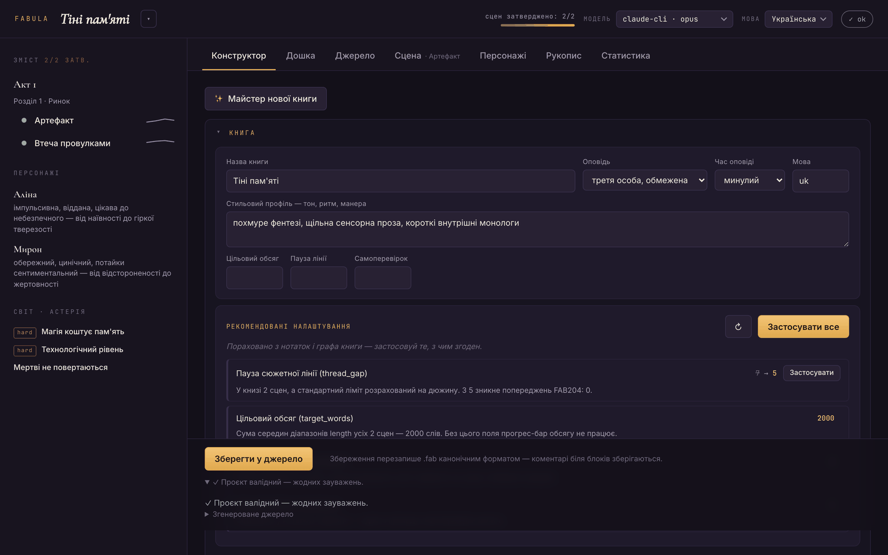
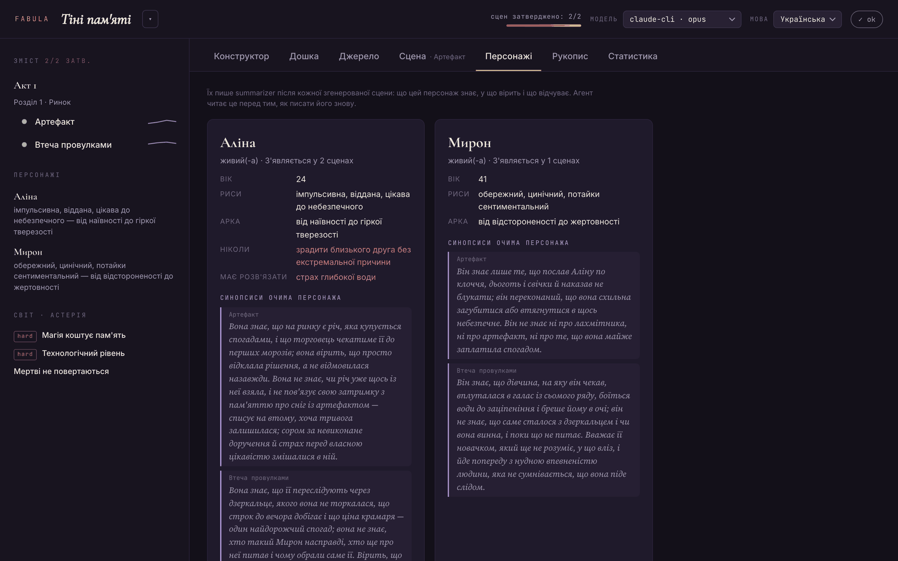
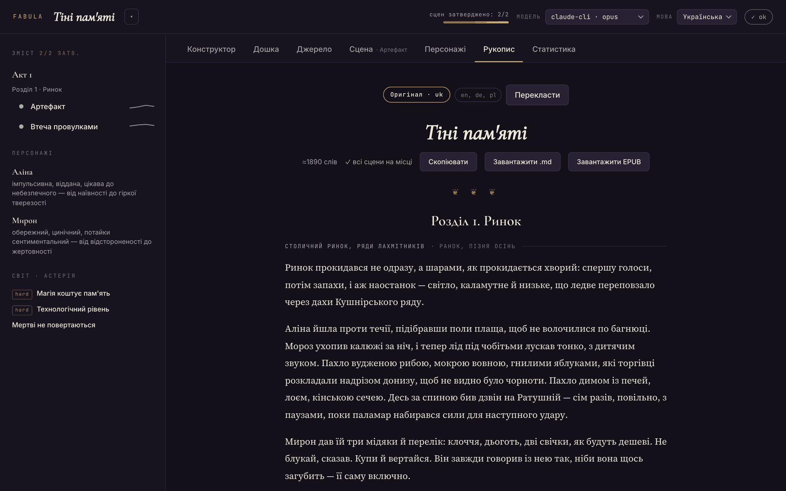

# Fabula — AI-first мова для агентів, що пишуть книжки

[](https://github.com/korshak/fabula/actions/workflows/ci.yml)

[English version](README.md)

DSL, де основний «споживач» коду — не людина, а агент-письменник, плюс локальний
веб-інтерфейс для редактора-людини.

## Як це виглядає



**Сцена** — прозі віддано всю сторінку, а збоку на рейці контракт сцени (POV,
локація, обов'язкові біти, заборони), перемикач варіантів із вердиктами
валідатора і пам'ять, з якою агент заходив у сцену.



**Конструктор** — книга редагується формою, а не синтаксисом: POV і склад
обираються з оголошених сутностей, напруга — повзунками, валідація жива, а
налаштування тула виводить із вашого ж графа й пропонує застосувати.



**Персонажі** — картка на персонажа, а під нею синопсиси з його точки зору, які
підсумовувач пише після кожної сцени: що він знає, чого ще не знає, у що вірить
і що відчуває. Агент вичитує це перед тим, як писати його знову, тож ніхто не
діє зі знанням, якого не міг мати.



**Рукопис** — затверджені сцени, зшиті в один текст під заголовками актів і
розділів, зі слаглайном над кожною сценою; копіюється, вивантажується в
Markdown, експортується в EPUB або йде агентові-перекладачу.

## Встановлення

Потрібен лише Python ≥ 3.10 — ядро без залежностей (стандартна бібліотека).

```bash
pipx install git+https://github.com/korshak/fabula.git
```

Або через pip (у venv): `pip install git+https://github.com/korshak/fabula.git`,
або з клонованого репозиторію: `pip install .` Провайдер Anthropic API — опційне
доповнення: `pip install "fabula-lang[anthropic]"`; провайдерам claude-cli та
openai-сумісним нічого додаткового не треба.

## Локальний сетап (з клону)

Потрібен лише інтерпретатор Python ≥ 3.10 — ядро використовує саму стандартну
бібліотеку.

**1. Клонувати й створити virtualenv**

```bash
git clone https://github.com/korshak/fabula.git && cd fabula
python3 -m venv .venv && source .venv/bin/activate
```

На Windows останній крок — `.venv\Scripts\activate`.

**2. Встановити**

```bash
pip install -e .
```

Так `fabula` з'являється в PATH і лишається прив'язаною до робочої теки —
правки діють без перевстановлення. SDK Anthropic ставте, лише якщо плануєте
провайдер `anthropic`: `pip install -e ".[anthropic]"`. Можна взагалі не
встановлювати й запускати `python3 -m fabula …` із кореня репозиторію.

**3. Підключити модель**

Поки жоден провайдер не доступний, генерація не працює. Профілі лежать у
[books/models.json](books/models.json) і діють на всю бібліотеку — беріть той,
що вже маєте:

```bash
# claude-cli — профіль за замовчуванням, без API-ключа: потрібен `claude` (Claude Code) у PATH
claude --version

# anthropic — SDK плюс ключ
pip install anthropic && export ANTHROPIC_API_KEY=...

# openai-сумісні — ключ у змінній, названій у полі api_key_env профілю
export OPENAI_API_KEY=...      # або GEMINI_API_KEY, OpenRouter, …
# локальному серверу (профіль `ollama`) ключ не потрібен узагалі
```

Ключі читаються тільки зі середовища — у `models.json` зберігається *ім'я*
змінної, ніколи її значення, тож файл безпечно комітити. Перевірити, що справді
живе:

```bash
fabula models "Тіні пам'яті"
```

Подробиці — де шукається конфіг, усі поля профілю, запуск локальної моделі — у
розділі [Моделі: як підключити провайдера](#моделі-як-підключити-провайдера).

**4. Запустити студію**

```bash
fabula serve
```

Відкриється http://127.0.0.1:8787 з книгою, над якою працювали востаннє, або з
прикладом. `--port 8899` змінює порт; `python3 run_ui.py 8899` — та сама точка
входу, якою користується конфіг запуску редактора.

**5. Написати щось**

```bash
fabula init моя-книга        # створює books/моя-книга
fabula compile моя-книга     # діагностика у JSON
fabula plan моя-книга        # план
fabula write моя-книга -m claude-cli
fabula manuscript моя-книга -o book.md
```

### Де лежать дані

| шлях | що це | у git? |
|---|---|---|
| `books/<назва>/book.fab` | джерело книги | ваші книжки в gitignore; `books/Тіні пам'яті/` їде як приклад |
| `books/<назва>/build/` | згенерований стан: варіанти, схвалення, підсумки, переклади | ні |
| `books/models.json` | профілі провайдерів на всю бібліотеку | так (лише імена змінних) |
| `~/.fabula/projects.json` | нещодавно відкриті книжки для перемикача проєктів | поза репозиторієм |

Три змінні середовища це налаштовують: `FABULA_BOOKS` виносить бібліотеку за
межі клону, `FABULA_HOME` переносить `~/.fabula`, а `FABULA_LANG` (`uk` або `en`)
задає мову інтерфейсу та згенерованих заготовок. Якщо `FABULA_LANG` не задано,
інтерфейс іде за локаллю системи, а якщо такої мови немає — за англійською. Мова
інтерфейсу не впливає на промпти до моделі-письменника: ті йдуть за налаштуванням
`language` самої книги.

### Якщо щось не працює

- **`fabula: command not found`** — не активований virtualenv або пропущене
  встановлення; `python3 -m fabula …` із кореня репозиторію працює завжди.
- **`Address already in use`** — порт 8787 зайнятий: `fabula serve --port 8899`.
- **Провайдер показано як недоступний у `fabula models`** — у повідомленні є
  причина: немає `claude` у PATH, не встановлено пакет `anthropic`, не задано
  змінну з ключем або локальний endpoint не відповідає.
- **Бібліотека порожня** — `fabula serve` потребує хоча б однієї книги: спершу
  `fabula init моя-книга` або клонуйте разом із книгою-прикладом.

## Швидкий старт

```bash
fabula init моя-книга
```

```bash
fabula serve
```

`init` створює каркас книги (`book.fab` + `models.json` + `.gitignore`) у теці
`books/моя-книга`, `serve` відкриває веб-студію на http://127.0.0.1:8787 з
останньою книгою бібліотеки. Далі — вкладка «Конструктор». Мова стартового
каркаса і консолі: `--lang en` чи `FABULA_LANG`.

**Бібліотека.** Усі книжки живуть у теці `books/` — по теці на книгу, і в ній
все про цю книгу: джерело `book.fab`, налаштування моделей `models.json` і
згенерований стан `build/` (варіанти сцен, затвердження, резюме, переклади).
Тому книгу можна перенести, скопіювати чи видалити однією текою. Команди беруть
**назву** книги (`fabula plan моя-книга`), а не шлях; явний шлях до `.fab` теж
працює. Інше місце для бібліотеки — змінна `FABULA_BOOKS`.

- **Декларативні контракти замість промптів.** Книга описується формально: світ,
  жорсткі правила (`severity: hard`), персонажі з обмеженнями (`never`, `must_resolve`)
  і полями-питальником (`appearance`, `voice`, `wants`, `fears`, `secret`),
  локації з деталями п'яти чуттів, іменовані сюжетні лінії (`thread`),
  сцени з обов'язковими бітами (`show`), заборонами (`forbid`), складом (`cast`),
  смертями (`kill`), просуванням ліній (`threads`), кривою напруги і обсягом.
- **Сюжетні лінії під наглядом.** Сцени декларують, які лінії просувають;
  компілятор дає помилку на неоголошену лінію (`FAB109`) і попереджає, коли
  лінія ніде не рухається (`FAB203`) або мовчить понад `thread_gap` сцен
  поспіль (`FAB204`).
- **Машиночитна діагностика.** Компілятор видає JSON зі стабільними кодами помилок
  і полем `hint`, щоб агент міг сам виправити джерело. Серед перевірок — континуїті:
  `FAB108` не дасть мертвому персонажу з'явитися в наступній сцені.
- **Пам'ять між сценами.** Кожна написана сцена стискається у резюме зі
  структурованими змінами станів персонажів; наступні сцени отримують блок
  «Що сталося раніше» (ієрархічно: останні N сцен — повністю, давніші — одним
  реченням; N задається `memory_window: 5;` у налаштуваннях книги, типово 3)
  і «Стан персонажів перед сценою» (живий/мертвий, остання локація, свіжі
  семантичні зміни). Резюме завжди свіже: перегенерація його перезаписує, а
  затвердження іншого варіанта запускає перерезюмування (без доступної моделі —
  резюме позначається застарілим).
- **Синопсиси очима персонажів.** Summarizer додатково фіксує власну картину
  кожного присутнього персонажа: що він знає, чого досі не знає, у що вірить
  (навіть помилково), що відчуває. Леджер повертає це агенту, щоб ніхто не
  діяв на знанні, якого не міг мати; вкладка «Персонажі» показує історію
  очима кожного.
- **Шаблони сюжету.** `fabula init моя-книга --template heros_journey` (або
  майстер у студії) розгортає класичну структуру — універсальні три акти,
  шлях героя, детектив, романтика, семиточкове оповідання — в акти й
  сцени-заглушки зі стартовими бітами мовою книги.
- **Цикл генерація → самокритика → самовиправлення.** Агент генерує N варіантів,
  валідатор перевіряє кожен на порушення контракту, і при порушеннях агент сам
  переписує текст (кількість ревізій — `revisions: 2;` у налаштуваннях, типово 1).
  Людина затверджує найкращий варіант, редагує його руками прямо в UI,
  лишає інлайн-коментарі до виділених фрагментів (як у Google Docs) —
  «Внести правки» робить точкову ревізію: змінюються лише закоментовані
  фрагменти, сюжет лишається недоторканим — або перегенеровує сцену з нуля
  з текстовою нотаткою — з затверджених сцен збирається рукопис.
- **Промпти мовою книги.** Інструкції моделі-письменнику генеруються мовою з
  налаштування `language` книги (шаблони — у `fabula/locales/`, фолбек — англійська).
- **Самовиправлення.** `fabula fix` віддає діагностику агенту, отримує виправлене
  джерело і приймає його лише якщо воно знову компілюється.

## Веб-інтерфейс

```bash
fabula serve "Тіні пам'яті"     # книга-приклад із репозиторію
```

Відкрий http://127.0.0.1:8787 — там:

- **Проєкти**: меню ▾ біля назви книги перемикає між книгами без перезапуску
  сервера — нещодавні проєкти (запам'ятовуються в `~/.fabula/projects.json`),
  список усього, що лежить у `books/`, відкриття книги за назвою або шляхом,
  створення нової книги за назвою (каркас створюється сам у `books/`, одразу
  відкривається майстер). Кожна книга має власний `build/` поруч із `book.fab`,
  а запущені джоби переживають перемикання туди й назад;
- **Джерело**: редактор `.fab` з діагностикою (клік по помилці веде до рядка)
  і кнопкою «Виправити агентом»;
- **Конструктор**: формовий редактор проєкту без ручного набору синтаксису —
  книга/світ/правила/персонажі/локації/лінії/структура. POV, склад і лінії
  сцени вибираються зі списків (неможливо вписати неіснуюче), обсяг — числами,
  крива напруги — повзунками 0…1, біти/заборони — списками. Валідація і
  згенероване джерело оновлюються наживо; «Зберегти у джерело» перезаписує
  `.fab` канонічним форматом (коментарі біля блоків зберігаються);
  перейменування сцени автоматично мігрує її варіанти й пам'ять.
  **Майстер нової книги** проводить крізь премісу → персонажів → шаблон
  сюжету і створює всю структуру;
- **Дошка**: коркова дошка — картки сцен по розділах, перетягування змінює
  порядок (у розділі чи між розділами, зберігається в канонічне джерело),
  а нижче — карта «лінія × сцена»: де кожна лінія рухається і де мовчить;
- **Сцена**: читацька колонка з текстом на всю висоту сторінки, а поруч — липкий
  контракт сцени (POV, біти, заборони), генерація і пам'ять агента; перемикач
  варіантів із вердиктами валідатора, WYSIWYG-редагування в тій самій
  типографіці (заголовки, жирний, курсив, закреслений, код, цитати, списки й
  задачі, посилання, таблиці, роздільник сцени — з перемиканням на вихідний
  Markdown), затвердження, режим «Читати» без панелей;
- **Персонажі**: картка-профіль кожного (поля-питальник, обмеження,
  живий/мертвий, у скількох сценах) і накопичені синопсиси його очима —
  сцена за сценою;
- **Рукопис**: зібраний текст із затверджених сцен, прочитаний структурою —
  заголовок акту й глави, а над кожною сценою рядок «де · коли» з контракту;
  копіювання, Markdown або готовий **EPUB** для будь-якої читалки (заголовки
  розділів мовою книги). Рядки «де · коли» — підказка для автора: у копію,
  `.md` і EPUB іде чиста проза.
  Тут же — **переклади**: агент-перекладач переносить затверджені сцени
  будь-якою мовою зі збереженням авторського стилю (ритм, регістр, образність);
  глосарій на книгу тримає імена, терміни й назви розділів однаковими, а після
  правок перекладаються лише сцени, що змінилися. Кожен переклад експортується
  в Markdown/EPUB так само, як оригінал;
- **Статистика**: слова по сценах і по днях письма, лічильник затверджених
  сцен, прогрес до `target_words`;
- зміст із статусами сцен (◦ чернетка / ◐ згенеровано / ● затверджено)
  і спарклайнами кривої напруги.

Сервер — чистий stdlib; `anthropic` потрібен лише для генерації.

> У `build/` зараз лежать **демо-варіанти** сцени «Артефакт» (позначені в тексті),
> щоб інтерфейс було видно одразу. Видали `build/` або перегенеруй сцену — і вони зникнуть.

## Моделі: як підключити провайдера

Fabula не звертається до моделі, доки ви не вкажете, до якої саме. Бекендів три;
**`claude-cli` не потребує API-ключа взагалі** і стоїть за замовчуванням.

### Де лежить конфіг

Провайдери описуються в `models.json`. Fabula шукає його в такому порядку і бере
перше влучання:

1. `books/<ваша-книга>/models.json` — налаштування однієї книги
2. `books/models.json` — спільна умова для всієї бібліотеки (саме він у репозиторії)
3. `./models.json` — поточна тека

Якщо файлу немає ніде, вмикається вбудований конфіг за замовчуванням — тож у
свіжому клоні всі п'ять профілів уже є. Писати `models.json` треба лише тоді,
коли щось змінюєте.

Перевірити стан будь-коли — команда друкує ще й те, який конфіг прочитала:

```bash
fabula models моя-книга
```

```
конфіг: /шлях/до/fabula/books/models.json
 → claude-cli   claude-cli opus                   ok
   claude-api   anthropic  claude-opus-5          недоступний — SDK не встановлено — виконай: pip install anthropic
   gpt          openai     gpt-5.2                недоступний — токен не задано — export OPENAI_API_KEY=...
   gemini       openai     gemini-2.5-pro         недоступний — токен не задано — export GEMINI_API_KEY=...
   ollama       openai     llama3.3               недоступний — немає з'єднання з http://localhost:11434/v1 — запусти сервер або виправ base_url
```

Стрілка позначає профіль за замовчуванням. У студії модель обирається селектором
у шапці, у CLI — прапорцем `-m <профіль>`. Кожен варіант сцени пам'ятає, який
провайдер його написав.

### `claude-cli` — без API-ключа

Використовує консольну тулу `claude`, яка у вас уже є від Claude Code, у
headless print-режимі й під вашою наявною автентифікацією Claude Code. Нічого
встановлювати, крім самої CLI, і жоден ключ не потрапляє в конфіг.

```bash
claude --version        # має бути в PATH
```

```json
{"type": "claude-cli", "model": "opus"}
```

`model` передається як `--model`, тож підходить усе, що приймає CLI (`opus`,
`sonnet`, `haiku`, повний id моделі); можна не вказувати — тоді буде дефолт самої
CLI. Під капотом Fabula запускає
`claude -p --output-format json --max-turns 1`, подає промпт у stdin, а «біблію
книги» — через `--append-system-prompt`.

Якщо генерація падає з помилкою автентифікації — запустіть `claude` один раз
інтерактивно й залогіньтесь.

### `anthropic` — через SDK

```bash
pip install anthropic
export ANTHROPIC_API_KEY=...      # або: ant auth login
```

```json
{"type": "anthropic", "model": "claude-opus-5"}
```

`model` обов'язковий. Цей бекенд стрімить, використовує адаптивне мислення,
кешує префікс «біблії книги» між викликами, а на `claude-opus-5` /
`claude-fable-5` вмикає server-side refusal fallbacks. Креденшели бере SDK, тож
профіль з `ant auth login` працює й без заданої змінної.

### `openai` — будь-який OpenAI-сумісний endpoint

Звичайний HTTP до `{base_url}/chat/completions`, без SDK. Працює з OpenAI,
OpenRouter, compat-endpoint Gemini, Ollama, llama.cpp, LM Studio, vLLM — усім,
що говорить цим протоколом.

```json
{"type": "openai", "base_url": "https://api.openai.com/v1",
 "model": "gpt-5.2", "api_key_env": "OPENAI_API_KEY"}
```

`base_url` і `model` обов'язкові. `api_key_env` — це **ім'я змінної середовища**
з токеном; сам токен читається зі середовища в момент виклику й ніколи не
зберігається в `models.json`, завдяки чому цей файл безпечно комітити. Локальним
серверам ключ зазвичай не потрібен: приберіть `api_key_env`, і Fabula замість
пошуку токена просто перевірить, чи endpoint відповідає.

```bash
# локальна модель, узагалі без ключа
ollama serve && ollama pull llama3.3
```

```json
{"type": "openai", "base_url": "http://localhost:11434/v1", "model": "llama3.3"}
```

### Поля профілю

| поле | для кого | що означає |
|---|---|---|
| `type` | усі | `claude-cli` \| `anthropic` \| `openai` |
| `model` | усі | id моделі; обов'язковий для `anthropic` і `openai` |
| `base_url` | `openai` | корінь endpoint, має починатися з `http://` або `https://` |
| `api_key_env` | `openai` | ім'я змінної середовища з токеном (великими літерами) |
| `timeout` | усі | секунд на виклик, за замовчуванням 900 |
| `extra_params` | `openai` | об'єкт, що домішується в тіло запиту (`temperature`, `top_p`, …) |
| `probe` | `openai` | примусово вмикає чи вимикає перевірку доступності; увімкнена, коли немає `api_key_env` |

Назви профілів — літери, цифри й дефіси. Ключ верхнього рівня `"default"`
визначає, який профіль береться, коли не вказано інший; якщо він називає
неіснуючий профіль, буде взято перший. Повний приклад —
[books/models.json](books/models.json).

### Комбінування провайдерів

Профіль обирається на кожен виклик, тож ніщо не заважає чернетити одною моделлю,
а перевіряти іншою:

```bash
fabula write моя-книга -m claude-cli     # чернетка локально, без ключа
fabula write моя-книга -m gpt            # друга думка про ту саму сцену
fabula translate моя-книга --to en -m claude-api
```

## CLI

Після встановлення доступна команда `fabula` (у клонованому репозиторії без встановлення — `python3 -m fabula`).

```bash
fabula init моя-книга                     # каркас нової книги в books/
fabula init моя-книга --template mystery  # …із шаблону сюжету
fabula templates                          # список шаблонів сюжету
fabula compile моя-книга                  # JSON-граф + діагностика
fabula plan моя-книга                     # план книги
fabula models моя-книга                   # профілі моделей і статус
fabula prompt моя-книга -s "Артефакт"     # промпти агента
fabula write моя-книга -m claude-cli      # генерація через claude CLI
fabula fix моя-книга --dry-run            # авторемонт джерела
fabula manuscript моя-книга -o book.md
fabula epub моя-книга -o book.epub        # експорт для читалок
fabula translate моя-книга --to en        # переклад зі збереженням стилю
fabula manuscript моя-книга --translation en -o book.en.md
fabula epub моя-книга --translation en -o book.en.epub
fabula serve                              # веб-інтерфейс на всю бібліотеку
```

## Локалізації

Усі користувацькі рядки (веб-інтерфейс, CLI, діагностика компілятора, помилки
провайдерів, прогрес агента) живуть в окремих файлах `fabula/locales/<код>.json`.
З коробки — українська та англійська; без явного налаштування береться мова
локалі системи, інакше англійська. Мова перемикається селектором у шапці
інтерфейсу, а в CLI — прапорцем `--lang en` або змінною `FABULA_LANG=en`.

Щоб додати нову мову, достатньо покласти новий JSON у `fabula/locales/` —
без жодних змін у коді. Покрокова інструкція для контриб'юторів:
[fabula/locales/README.md](fabula/locales/README.md). Неповні переклади
працюють — відсутні ключі підставляються з англійської. Форми множини
підтримуються (`"3 правила"`, `"5 правил"`).

Мова інтерфейсу не впливає на промпти моделі-письменнику — їхня мова
прив'язана до книги, що пишеться.

## Синтаксис

```
book "Назва" {
  voice: "third_person_limited";
  world "Світ" {
    rule "Правило" { description: "..."; severity: hard; }
  }
  character "Ім'я" { traits: ["..."]; never: "..."; }
  act 1 {
    chapter 1 "Назва" {
      scene "Назва" {
        pov: "Ім'я";
        cast: ["Інший"];
        kill: "Хтось";          // смерть у цій сцені; далі персонаж недоступний
        length: 900..1200;
        variants: 2;
        tension: [0.2, 0.6, 0.9, 0.4];
        show: "що має статися на сторінці";
        forbid: "чого не може бути";
      }
    }
  }
}
```

Граматика навмисно регулярна: атрибути `key: value;`, вкладені блоки, рядки,
числа, діапазони `a..b`, списки `[...]`, коментарі `//`. Повторення ключа
(`show`, `forbid`) накопичується у список.

## Структура

- `fabula/lexer.py`, `fabula/parser.py` — токенізатор і рекурсивний спуск
- `fabula/compiler.py` — AST → граф книги + валідації (FAB1xx/FAB2xx, включно з континуїті)
- `fabula/prompts.py` — граф → промпти письменника/валідатора/ремонтника + пам'ять
- `fabula/serializer.py` — зворотний бік компілятора: граф → канонічний `.fab`
  (на ньому працює конструктор; раунд-тріп парсинг→серіалізація→парсинг без втрат)
- `fabula/providers.py` — бекенди моделей: claude-cli / anthropic / openai-сумісні
- `fabula/state.py` — стан проєкту (варіанти, затвердження, резюме) у `build/state.json`
- `fabula/agent.py` — агент поверх провайдера: генерація, самокритика, резюме, авторемонт
- `fabula/server.py` + `fabula/web/index.html` — веб-інтерфейс (stdlib HTTP + SPA)
- `fabula/markdown.py` — розмітка прози (той самий набір, що й у редакторі студії):
  Markdown → XHTML для експорту EPUB
- `fabula/cli.py` — команди CLI
- `fabula/library.py` — бібліотека книжок: пошук і створення книжок у `books/`
- `books/` — усі книжки: одна тека на книгу (`book.fab`, `models.json`, `build/`);
  `books/Тіні пам'яті/` і `books/Shadows of Memory/` — книги-приклади (та сама
  історія українською й англійською), решта теки не потрапляє в репозиторій
- `run_ui.py` — dev-точка входу для сервера (обхід обмежень macOS на запуск із Documents)

## Розробка і пакування

Пакет описано в [pyproject.toml](pyproject.toml): нуль обов'язкових залежностей,
extra `[anthropic]`, локалі та веб-інтерфейс їдуть усередині wheel. Локальна
розробка: `pip install -e .` (або просто `python3 -m fabula ...` з кореня репо).
Реліз: `python3 -m build` → `dist/*.whl` + `dist/*.tar.gz`.

```bash
python3 -m unittest discover -s tests -t .
```

Тести — на стандартному `unittest`, без мережі й без API-ключа. CI ганяє той
самий набір на Linux, macOS і Windows для Python 3.10–3.13.
Як контриб'ютити: [CONTRIBUTING.md](CONTRIBUTING.md).

## Приватність і безпека

Fabula працює цілком на вашій машині. Немає жодного сервісу Fabula, акаунтів і
телеметрії — єдиний трафік, який вона створює, це запит до того провайдера
моделі, якого ви налаштували самі. Ваші книжки не залишають теку, де лежать.

API-ключі читаються лише зі змінних середовища. `models.json` зберігає *ім'я*
змінної, а не її значення — тому цей файл безпечно комітити.

`fabula serve` слухає лише `127.0.0.1` і не має входу з паролем. Він захищений
від браузера — сторонній сайт не може ним керувати, а домен, переприв'язаний до
`127.0.0.1`, до нього не достукається, — але не від самої машини: будь-хто з
обліковим записом на цьому ж хості може. Запускайте на машині, яку контролюєте,
і не відкривайте порт назовні. Знайшли дірку? [SECURITY.md](SECURITY.md).

## Ліцензія

Fabula поширюється за [PolyForm Noncommercial License 1.0.0](LICENSE) —
**вільно для будь-якого некомерційного використання, комерційне заборонено** без
окремої ліцензії. Це стосується всього інструментарію і будь-якої його частини:
не можна вийняти з проєкту модуль, компілятор, шаблони промптів чи студію й
використати їх комерційно.

Дозволено без жодних запитів: особисті проєкти, письмо для себе, навчання й
дослідження, викладання, а також використання благодійними організаціями,
школами, університетами, державними дослідницькими установами та органами влади
— зокрема й написання книжок, які ви продаєте, бо обмеження стосується
комерціалізації *програми*, а не вашої прози. Форкати, змінювати й поширювати
теж можна, доки результат лишається некомерційним і несе ліцензію із собою.

Не дозволено: використання Fabula в операційній діяльності компанії, побудова на
її основі продукту чи платного сервісу, включення її у щось, що ви продаєте. Для
цього відкрийте [issue](https://github.com/korshak/fabula/issues), щоб домовитися
про комерційну ліцензію.

Зверніть увагу: це свідомо **не** open-source ліцензія в розумінні OSI.
